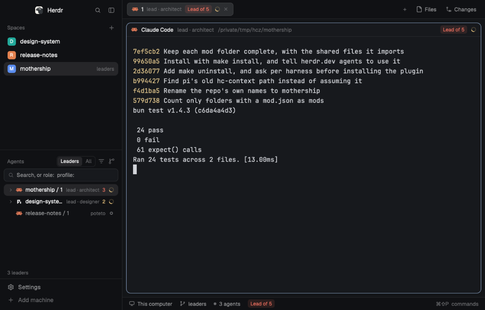
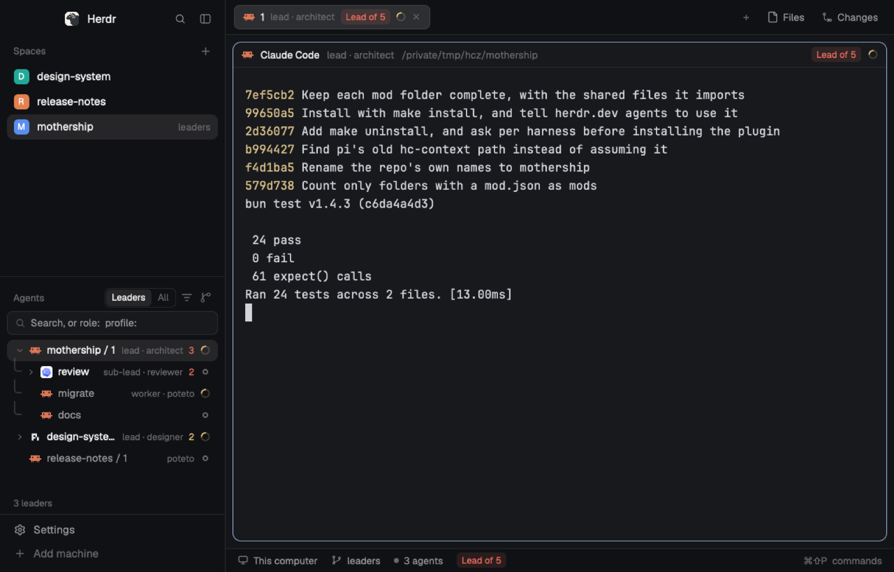
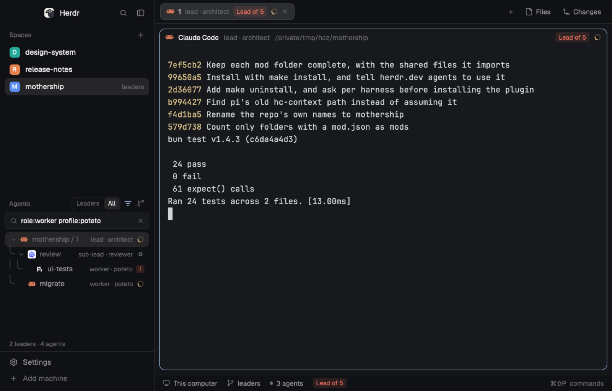
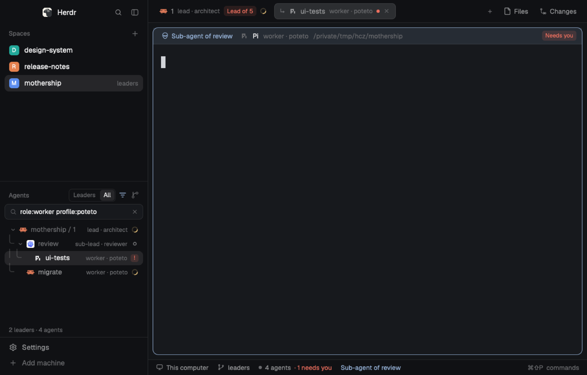

# Mothership

**Your agents start agents. Those start more. Soon the Agents list is
thirty terminals and you can't tell who's in charge.**

Mothership shows you the leads. Choose **Org**, then **Leaders**, and
every crew folds away: all you see are the agents in charge, each with the
size of its crew. Talk to a lead. Open its crew only when you want to see
who's doing the work.



[A 15-second video](docs/herdr-org/media/org-view.mp4) shows the leads,
one lead's crew, the whole org, a search, and a worker's button back to
its lead.

Mothership is a layout for [Herdr](https://herdr.dev), the desktop app for
agents and terminals.

## Install

Keep Herdr 0.1.12 open. You need `hc`, `herdr-app`, `git`, `make`,
`python3` and `rsync`.

```sh
git clone https://github.com/hassox/mothership.git
cd mothership
make install
```

In a terminal, `make install` asks, for each agent app it finds (Claude
Code, Codex, Grok Build, `agy`, pi), whether to add the `hc-context`
plugin. The plugin lets agents label themselves and the agents they start.

Then, in the Agents list, open the sort menu at the right of the header,
choose **Org**, then **Leaders**.

If you use Codex, open `codex` once and trust the `hc-context` hook. Codex
runs a new or changed hook only after you trust it.

Keep the cloned folder: the launcher, `~/.local/bin/herdr-org-launch`,
links into it. Put `~/.local/bin` on your `PATH` to use it. To remove Mothership, see [Uninstall](#uninstall).

## Working with your leads

Choose **Org** in the sort menu. The list has two views:

- **Leaders** starts with every crew folded, so you see only the agents in
  charge. A lead's number is how many agents are in its crew right now,
  colored by the most urgent agent anywhere beneath it; hover it for the
  breakdown. Click a lead's arrow to see its crew, every agent it started.
  A crew member with a crew of its own has its own number and arrow.
- **All** shows every agent, crews open. You can fold any of them.



Click an agent's name to go to it.

**Order.** Whatever needs you comes first, then done, then working, then
idle. A lead ranks by its own status or its crew's, whichever is more
urgent, so the lead whose crew needs you is at the top.

**Labels.** Each row shows the agent's role and profile, such as
`worker · poteto`, when they are set.

**Every space.** The Org list shows agents from every space.

**Search.** To find a particular agent, choose **All** and type in the
search box: `review` keeps agents whose name, role, profile or folder
contains it, and `role:worker` keeps the workers. The filter button offers
values you can add to the search. More in [Search](#search).



## Roles and profiles

Both are labels on the agent's terminal. **Role** is the agent's job in
the crew, such as `worker` or `reviewer`. **Profile** is a name for how
the agent is set up, such as `poteto`. Neither changes what the agent
does; they show who's who.

- **Role.** The agent that starts a crew member gives it a role:

  ```sh
  hc run --bg --name fix --label org.role=worker -- herdr-org-launch poteto claude "Fix x.rs"
  ```

  Change it later with `hc label fix org.role=reviewer`. The `hc-context`
  plugin asks agents to label the crew they start.
- **Profile.** Set `HC_PROFILE` and the plugin labels the agent when it
  starts, for example with `alias poteto='HC_PROFILE=poteto claude'`.
  For an agent you start with `hc run`, use the launcher above:
  `herdr-org-launch <profile> <command>`. `hc run` does not pass your
  environment on, so `HC_PROFILE` alone would be lost.

## Back to the lead

A crew member's pane header starts with an alien and *Sub-agent of
`<lead>`*. Click it to go to the lead; click again there to go up another
level. Hover it for the lead's role and profile.



An agent you peek at has no button, because the peek bar is Herdr's own.
Open it as a tab to get one.

## Lead and crew marks

These show whichever list you use.

- **Tab bar.** A crew member's tab starts with `↳` and has dimmer text. A
  lead's tab shows *Lead of N*, the number of agents under it at every
  level, colored by the most urgent. Each tab shows its agent's role and
  profile.
- **Pane header.** A crew member's header is tinted and has the button
  back to its lead. A lead's header shows *Lead of N*.
- **Status bar.** The same mark for the agent you're focused on.

## Crews in the Spaces list

A crew shares its lead's space, unless the lead put it in another space
with the `herdr.space` label. Pick how the Spaces list shows crews in the
sort menu in the Agents header, or run the command from Herdr's command
palette:

| Mode | Command | What you see |
|---|---|---|
| Follow selected space (default) | `mothership-agents.follow` | The Agents list shows only the selected space's agents, with their crews under them. Org is not filtered. |
| Tree in Spaces | `mothership-agents.tree` | A space row shows its crew count and most urgent status. Click it to list the crew under the row. |
| Dots in Spaces | `mothership-agents.dots` | A dot for each crew member, up to six, then a count. Click for a card with each one's status and report. |
| Agents tab | `mothership-agents.tab` | A count on the space row. Click it to open an Agents tab with a card per crew member and the last lines of its screen. |
| Off | `mothership-agents.off` | Herdr's own behavior. |

## Commands and search

Run these from Herdr's command palette, or bind them to keys in
`~/.config/herdr-app/keys.json`, for example
`"global": { "cmd-shift-m": "mothership-agents.next" }`.

| Command | What it does |
|---|---|
| `mothership-agents.org` | Sort the Agents list as the org. |
| `mothership-agents.org-scope` | Switch between Leaders and All. |
| `mothership-agents.next` | Go to the next Spaces mode. |
| `agent.next`, `agent.prev` | Go to the next or previous agent, in the order shown. |

### Search

| You type | Keeps |
|---|---|
| `review` | name, terminal ID, role, profile or folder contains `review` |
| `role:worker` | role contains `worker` |
| `profile:poteto` | profile contains `poteto` |
| `harness:codex`, `machine:vps`, `status:blocked` | that field contains the value |
| `role:worker role:reviewer` | either role (the same key twice is OR) |
| `role:worker profile:poteto api` | all three (different keys and words are AND) |
| `profile:"two words"` | a value with spaces |

A row stays when it, or an agent in its crew, matches.

## Installing some of it

`make install` installs everything. To install only some pieces, name
them; `make -n <name>` shows what a name would install without doing it.

```sh
make mothership-agents mothership-pane
```

| Name | What it adds | Also installs |
|---|---|---|
| `mothership-agents` | The Agents list: Org, the crew modes and Follow. | |
| `mothership-pane` | The pane header: labels, *Lead of N*, the button back to the lead. | |
| `mothership-tabs` | The tab bar: labels, `↳` and *Lead of N*. | |
| `mothership-status` | The status bar mark. | |
| `mothership-spaces` | The Spaces list: the Tree, Dots and Agents tab modes. | `mothership-agents`, `mothership-crew` |
| `mothership-crew` | The Agents tab that the Agents tab mode opens. | |
| `launcher` | `herdr-org-launch` in `~/.local/bin`. | |
| `plugin` | The `hc-context` plugin, in the agent apps you choose. | |

Most of these replace a Herdr panel of the same job in a layout called
`mothership`, which `make` copies from your `main` layout the first time.
Panels you don't install stay Herdr's own, and `make` switches the window
to `mothership`. `layout.switch` (`cmd-shift-l` on macOS) switches
layouts.

`make` copies each mod into `~/.config/herdr-app/mods/`. It stops rather
than replace a folder there that it did not install.

To pick agent apps without being asked, name them:

```sh
make plugin HARNESSES="claude pi"
```

When `make` runs without a terminal, as when an agent runs it, it installs
into every app it finds unless `HARNESSES` says otherwise. It skips apps
that already have this repo's `hc-context`.

### Moving from agent-files

`hc-context` used to come from hassox/agent-files. Remove that copy first,
or its hook runs twice:

```sh
claude plugin uninstall hc-context@hassox-agent-files
codex plugin remove hc-context@hassox-agent-files
grok plugin uninstall hc-context
agy plugin uninstall hc-context
pi remove "$(pi list | sed -n 's#^ *\(/.*/agent-files/plugins/hc-context\)$#\1#p')"
```

Then run `make install`.

## Uninstall

```sh
make uninstall
```

removes everything `make` installs. Like `make`, it needs Herdr open. To
remove one piece, put `uninstall-` in front of its name:

```sh
make uninstall-mothership-pane uninstall-plugin
```

| Name | What it removes |
|---|---|
| `uninstall-layout` | Switches the window to `main`, then deletes the `mothership` layout. |
| `uninstall-<mod>` | That mod, putting Herdr's own panel back where it replaced one. Removing `mothership-agents` or `mothership-crew` also removes `mothership-spaces`, which needs them. |
| `uninstall-launcher` | `~/.local/bin/herdr-org-launch`, if it points into this folder. |
| `uninstall-plugin` | `hc-context` from each agent app that has it. `HARNESSES` limits it to the ones you name. |

## Developing

Edit the files here, not the copies in `~/.config/herdr-app/mods/`. After
editing `shared/`, run `make sync`; then run `make install`. Herdr reloads
a mod when its files in `~/.config/herdr-app/mods/` change. It does not
follow links, so `make` copies.

- `mods/`: copies of Herdr 0.1.12's own panels, changed.
  `mothership-agents` (from `agents`) has Org, the modes and Follow.
  `mothership-spaces` (from `spaces`) has the Tree, Dots and Agents tab
  chips. `mothership-tabs` (`tabs`), `mothership-pane` (`pane`) and
  `mothership-status` (`workspace-status`) have the marks.
  `mothership-crew` is new: the Agents tab. It reads each crew member's
  screen and branch every 5 seconds, only while the tab is in front.
- `shared/`: code more than one mod uses. Herdr loads only files inside a
  mod's own folder, so each mod holds a copy; `make sync` updates them.
- `plugins/hc-context/`: the plugin, with a manifest and hook for each
  agent app.
- `bin/herdr-org-launch`: the launcher.
- `Makefile` and `scripts/`: install and uninstall.
- `layouts/mothership.json`: the full layout, for herdr.dev.
- `docs/herdr-org/`: the design notes and media.
- `RECIPE.md` and `preview.png`: the herdr.dev listing.

Copies don't get Herdr's updates. When Herdr ships a new version of one
of these panels, copy it again and move these changes onto it.

### Tests

```sh
bun run check
```

It checks every mod with `herdr-app check`, then runs `bun test`. The
tests need `hc`, `herdr-app` and `bun`, and no model keys. The tests that
run agents use their own scratch `hc` under `/tmp`, never yours, with fake
agents.

To run the checks before each commit:

```sh
git config core.hooksPath .githooks
```

`test/demo-org.sh` starts a small fake org under your current terminal;
`test/demo-org.sh --clean` removes it.
