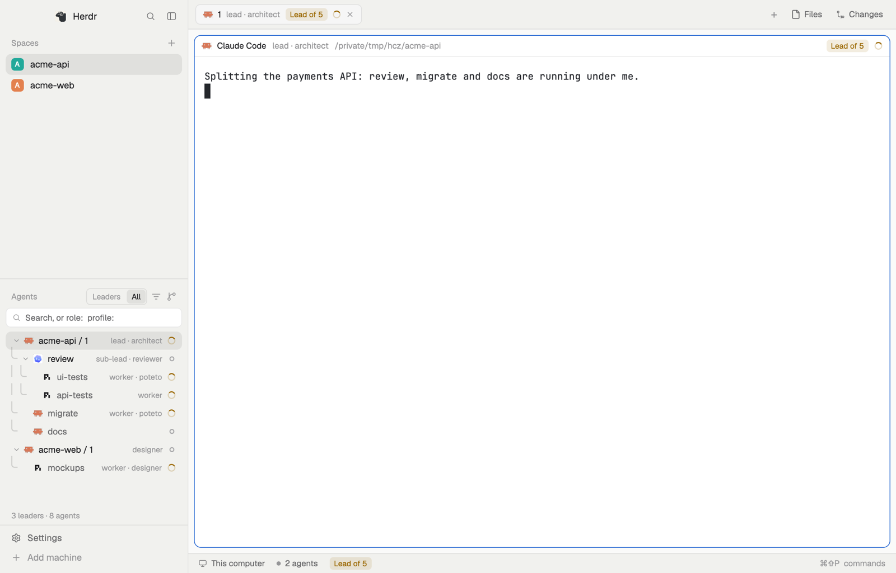

# Mothership

Herdr's `main` layout, rebuilt around agents that start other agents. The
Agents list can show your agents as an org: each leader with the agents it
started, nested at any depth, with each agent's role and profile. A search
box filters the org by name, role, profile, harness, machine or status.
Sub-agents are marked in the tab bar, the pane header and the status bar,
and a sub-agent's pane header takes you to its leader in one click.



**To install it, clone the repo and run `make install`** (it needs `make`,
`python3`, `rsync` and Herdr open):

```sh
git clone git@github.com:hassox/mothership.git
cd mothership
make install
```

Do not copy the mod folders by hand. The mods share `shared/subagents.js`
and `shared/org.js`, which `make` copies into each mod, and `make` also
installs the `hc-context` plugin that tags agents, and the
`herdr-org-launch` launcher. Ask the person before the plugin step: in a
terminal `make` asks per harness; from an agent, run
`make install HARNESSES="<the harnesses they chose>"` (any of `claude`,
`codex`, `grok`, `agy`, `pi`). `make uninstall` removes it all.

## What you see

Left to right: a 268 px sidebar, then the work area.

- **Sidebar, top.** Herdr's brand row (46 px), then Spaces and Agents
  sharing the height equally (each at least 90 px), then the footer
  (69 px). Theme color `chrome`.
- **Spaces.** Herdr's spaces list. A space row can show its sub-agents in
  the mode the Agents header chooses (below).
- **Agents header.** "Agents", then, in the Org view, a two-way toggle
  **Leaders | All**, a filter button (three lines, `accent` while a search
  is on, else `dim`), and the sort button.
- **Org view.** A 28 px search box with a search icon and the placeholder
  "Search, or role:  profile:", and an × that clears it. Under it, 26 px
  rows: tree lines in `input`, a fold chevron on a row with children, the
  program icon, the name, then `role · profile` in 11 px `dim` text, then
  a count of direct reports in the color of the most urgent status anywhere
  in the team below it (shown when those reports are hidden or folded),
  then the agent's own status badge. A footer reads "N leaders" (Leaders) or
  "N leaders · M agents" (All).
- **Names.** A top-level agent is named by where it shows ("acme-api / 1");
  a sub-agent by its own name.
- **Tab bar.** Each tab shows `role · profile` in 11.5 px `dim` text after
  its name. A sub-agent's tab starts with `↳` and has dimmer text. A lead's
  tab shows a *Lead of N* chip.
- **Pane header.** The program, its name, `role · profile` in `dim`, the
  folder. A sub-agent's header is tinted `accent` and starts with a grey
  alien icon and "Sub-agent of <leader>" in `accent`.
- **Status bar.** The machine, the branch, the agent count, and the focused
  terminal's sub-agent or lead mark.

Only labels that are set show. An agent with no role and no profile shows
no tag text at all.

## How it behaves

- **Leaders.** A leader is a live agent with no live parent, or any
  terminal with live children. The Leaders scope shows only leaders,
  nested at any depth, each with its count of direct reports. All shows
  every agent under its leader.
- **Status.** Working: a spinning ring in `working`. Needs you (blocked): a
  `!` in `blocked`. Done (finished while you were not looking): a filled
  dot in `done`. Idle: an open ring. A leader's count takes the color of
  the most urgent status anywhere in its team, and its tooltip gives the
  breakdown ("3 reports · team: 1 needs you, 2 working"). A sub-agent
  without a pane is not tracked as seen, so its `done` counts as idle.
- **Order.** At every depth, rows rank by the more urgent of their own
  status and their team's: needs you, done, working, idle. Equal ranks keep
  Herdr's order. The Org view sets `setAgentOrder` to its rows, so
  `agent.next` and `agent.prev` follow them.
- **Search.** A bare word matches name, address, role, profile or folder.
  `role:`, `profile:`, `harness:`, `machine:` and `status:` match one field.
  The same key twice is OR; different keys and words are AND. Quotes keep
  a value with spaces together. Case does not matter. A row stays when it
  or a row under it matches; rows kept only for context are `dim`.
- **Filter popup.** Lists every role, profile, harness, machine and status
  in the shown tree with counts. Ticking one adds its `key:value` to the
  search; unticking removes it. "Clear all" empties the search.
- **Clicks.** A row with a pane focuses it; a row without one peeks it. The
  chevron folds a leader. The pane header's alien and "Sub-agent of X" run
  `agent.focus` on the parent; clicking again at that leader goes up one
  more level. Its tooltip is "Take me to your leader: <name> · <role> ·
  <profile>".
- **Commands.** `mothership-agents.org` selects the Org view.
  `mothership-agents.org-scope` flips Leaders and All. The sub-agent modes are
  `mothership-agents.follow`, `.tree`, `.dots`, `.tab`, `.off` and `.next`.
- **Live.** Every view rebuilds from Herdr's `terminals()` on each render,
  so a new label, a new child or an ended child shows at once. Nothing
  polls.

## Built from

- **Layout.** `layouts/mothership.json`, a clone of `main` 0.1.12 whose blocks
  name the `mothership-*` mods; `"preview": "layouts/mothership.png"`.
- **Mods.** Clones of Herdr's 0.1.12 mods: `mothership-agents` (`agents`),
  `mothership-spaces` (`spaces`), `mothership-tabs` (`tabs`), `mothership-pane`
  (`pane`), `mothership-status` (`workspace-status`). Plus `mothership-crew`, the
  Agents tab, which runs `hc read` and `git branch --show-current` every
  5 s while it is in front.
- **Shared code.** `shared/subagents.js` (parents, sub-agent trees, marks)
  and `shared/org.js` (the org tree, search, filter values, tag text). Each
  mod gets a copy, because a mod loads files only from its own folder.
- **Data.** `terminals()`: `parent`, `labels["org.role"]`,
  `labels["org.profile"]`, `labels.where`, `labels["herdr.space"]`,
  `status`, `report.app`. `shared()`: `agents.sort`, `org.scope`,
  `org.filter`, `mothership.mode`.
- **Commands it runs.** `pane.focus`, `terminal.peek`, `agent.focus`,
  `terminal.pin`, `space.select`, `layout.resize`.
- **Tags come from outside the layout.** `org.role` is set by the agent that
  starts a sub-agent: `hc run --label org.role=<role> …`. `org.profile` is
  set by the agent itself: the `hc-context` plugin's start hook, or
  `herdr-org-launch <profile> <command>`, runs
  `hc label "$HC_TERMINAL_ID" org.profile=<profile>`.
- **Art.** `mods/mothership-agents/filter.svg`, `mods/mothership-pane/alien.svg`,
  and Herdr's `workspace-chrome` icons.

## Watch out

- Herdr does not see edits made through a symlinked mod folder, and a pane
  header keeps its build across a layout switch. Copy the mods into
  `mods/`; each saved file then reloads every copy.
- `herdr-app check` renders a mod once with empty data, so it cannot catch
  a crash on real terminals.
- `labels.where` is Herdr's own label, and a sub-agent inherits its
  parent's. Use it only for a terminal with no parent.
- `hc run` does not pass the caller's environment, so
  `HC_PROFILE=x hc run …` gives no profile. Put the profile in the child's
  command with `herdr-org-launch`.
- The peek bar is Herdr's `peek` mod, and a layout cannot replace it, so a
  peeked sub-agent has no leader button. Keep it as a tab to get one.
- A kept terminal that comes back as a shell keeps its old labels.

## Done when

- The Agents header's sort menu has **Org**, and choosing it shows the
  Leaders | All toggle, the filter button and the search box.
- With a lead that started a sub-lead that started two workers, Leaders
  shows the lead and the sub-lead with counts 1 and 2, and All shows all
  four.
- `hc label <worker> org.role=reviewer` changes that row's text at once.
- Typing `role:worker profile:poteto` keeps only the matching workers and
  their leaders.
- A kept sub-agent's pane header shows the alien, and clicking it shows its
  leader.
- An agent with no labels shows no tag text anywhere.
- `herdr-app check` passes for every mod.
